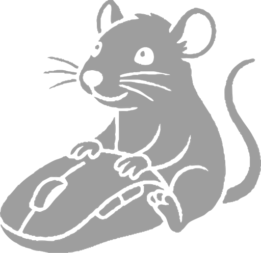

<p align="center">
  
</p>

# MoveMouse

A small macOS menu bar app that smoothly moves the cursor while you are idle, so other programs see user activity (the macOS counterpart of Move Mouse on Windows).

## Features

- Menu bar only (no Dock icon).
- Moves the mouse **only when the user is idle**; the idle threshold is configurable.
- Random direction and random distance (from 1 px up to a configurable maximum), kept within the screen bounds.
- Smooth ease-in-out animation, aborted as soon as the user touches the mouse.
- Configurable interval between movements.
- Schedule: per-day enable switch and working hours (week starts on Monday; ranges crossing midnight are supported).
- The menu bar icon turns green while the app is actually moving the mouse.
- Pauses while the screen is locked or another user is active (fast user switching).
- Optional launch at login (`SMAppService`).
- Settings persist between launches.

## Requirements

- macOS 14 or later
- Xcode to build; optionally [XcodeGen](https://github.com/yonaskolb/XcodeGen)

## Building

```sh
open MoveMouse.xcodeproj
```

or from the command line:

```sh
xcodebuild -project MoveMouse.xcodeproj -scheme MoveMouse -configuration Release -derivedDataPath build build
```

The app is produced at `build/Build/Products/Release/MoveMouse.app`. Set your own Team in *Signing & Capabilities* before running from Xcode.

Project configuration lives in `project.yml`; after changing it, regenerate the project with `xcodegen generate`.

## Permissions

Moving the cursor requires the **Accessibility** permission: *System Settings → Privacy & Security → Accessibility*. The app prompts for it from its menu.

For launch at login, copy the app to `/Applications` first.

## Project layout

- `MoveMouse/MoveMouseApp.swift` – the entire app
- `MoveMouse/Assets.xcassets` – rat icon (SVG)
- `project.yml` – XcodeGen project definition
- `docs/icon.png` – gray icon used in this README
